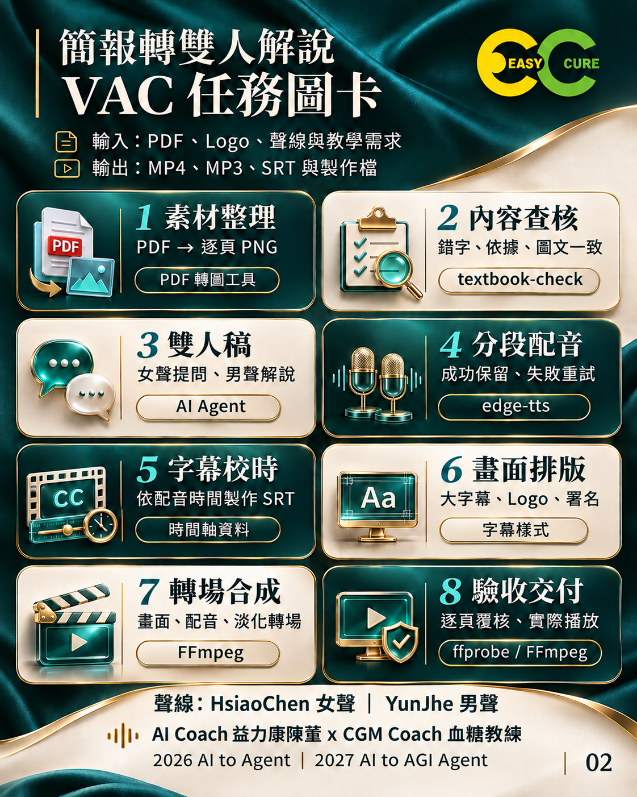
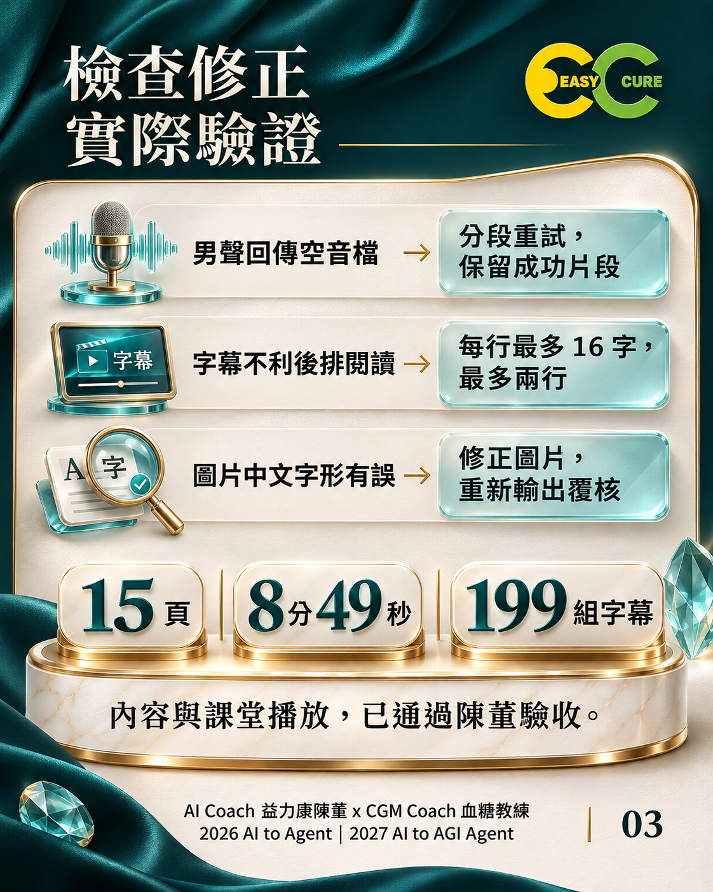
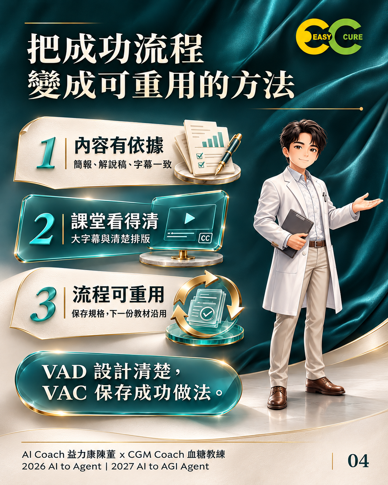

# 簡報轉雙人解說教學影片

**ai-to-agent-slide-to-video**｜用 VAC 任務圖卡，把 PDF 簡報製作成有男女配音、字幕與轉場的教學影片，再以檢查與實際播放驗收。

## 為什麼需要這個專案？

簡報完成後，還會遇到解說稿難寫、配音失敗、字幕不同步、投影看不清楚等問題。本專案保存一次實作中已完成的流程與修正經驗，讓教師、講師及企業教育訓練人員有可交辦、可檢查的依據。

這是 **方法論與任務規格專案**，不是安裝後自動完成所有工作的應用程式。使用者需提供素材，由具備檔案處理、配音及影音合成能力的 Agent 或製作人執行。

## 快速開始

1. 準備 PDF、公司 Logo，以及影片用途與受眾。
2. 複製 [任務需求表](templates/task-brief.md)，設定聲線、畫面與交付格式。
3. 將需求表和 [VAC 任務規格](docs/vac-task-card.md) 一起交給 Agent。
4. 先完成一段開場樣片，確認內容、聲音與投影可讀性，再完成全片。
5. 依 [驗收清單](templates/acceptance-checklist.md) 檢查，記錄失敗、修正與再驗證結果。

可以直接交辦：

> 請依本專案 VAC 規格，將附上的 PDF 製作成雙人解說教學影片。女聲使用 HsiaoChen，男聲使用 YunJhe。逐頁查核後才生成解說稿，先完成開場樣片；字幕須適合課堂投影。發現錯字、空音檔或時間不同步就修正，並留下檢查紀錄。未驗證的項目不得填寫通過。

## 工作流程

| 步驟 | 產出 | 核對重點 |
|---|---|---|
| 素材整理 | 逐頁 PNG | 頁數、順序、清晰度 |
| 內容查核 | 修訂圖片與紀錄 | 錯字、專有名詞、依據 |
| 雙人稿 | 逐頁問答稿 | 忠於簡報、角色分工 |
| 分段配音 | 音檔與合成紀錄 | 聲線正確、可解碼、非空音檔 |
| 字幕校時 | SRT 與時間軸 | 全文一致、無重疊、時序正確 |
| 畫面排版 | 樣片與字幕樣式 | 字級、對比、安全區 |
| 轉場合成 | MP4、MP3 | 轉場平順、聲畫對應 |
| 驗收交付 | 成片與驗收表 | 完整播放及實際課堂確認 |

工具依執行環境選擇；本次案例使用 PDF 轉圖、textbook-check 內容查核流程、edge-tts、FFmpeg 與 ffprobe。未把參考圖中的 WhisperX、OTIO 或 Remotion 宣稱為本次實際使用工具。

## 已完成案例

Creatine_System_Upgrade：15 頁、30 段配音、約 8 分 49 秒、199 組字幕。使用者已確認影片內容與上課播放沒有問題。詳見 [案例與證據界線](examples/creatine-case.md)。本次整理未重跑配音與整片渲染。

本套件不含原始醫學教材、完整影片或私人音訊；既有影片另行交付。範例成果不保證套用到其他內容時仍有相同長度、成本或效果。

## 文件與素材

- [VAC 任務規格](docs/vac-task-card.md)
- [檢查、修正與實際驗證](docs/verification.md)
- [青金珠光設計規範](docs/design-system.md)
- [社群文章](docs/social-article.md)
- [GEO／AEO／SEO 問答](docs/faq.md)
- [搜尋發布欄位](docs/search-publishing.md)
- [需求表](templates/task-brief.md)、[雙人稿格式](templates/dialogue-script.md)、[驗收清單](templates/acceptance-checklist.md)
- [案例](examples/creatine-case.md)、[素材來源](assets/README.md)
- [發布檢查](docs/release-check.md)、[版本紀錄](CHANGELOG.md)、[貢獻指南](CONTRIBUTING.md)

## 四張圖卡

| 01 痛點開場 | 02 VAC 任務圖卡 |
|---|---|
|  |  |

| 03 檢查與驗證 | 04 總結優點 |
|---|---|
|  |  |

## 適用範圍與限制

適合課程簡報、教育訓練與產品知識說明。不適合在未查核內容的情況下直接產出專業醫療建議。機密素材應依組織規範選擇處理方式。

## 版本與後續

版本 0.1.0，日期 2026-11-14。已完成文件與圖卡包；後續可依新教材驗證結果補充案例。已於 2026-11-14 公開發布並打 tag v0.1.0；尚未建立公開網站或 GitHub Release。

## 授權

[LICENSE](LICENSE) 為保留所有權利；本套件未授予一般公開再利用權。品牌署名不等於法律權利人認定，Logo、人物及第三方工具需分別處理。

---

AI Coach 益力康陳董 x CGM Coach 血糖教練 | 2026 AI to Agent | 2027 AI to AGI Agent
